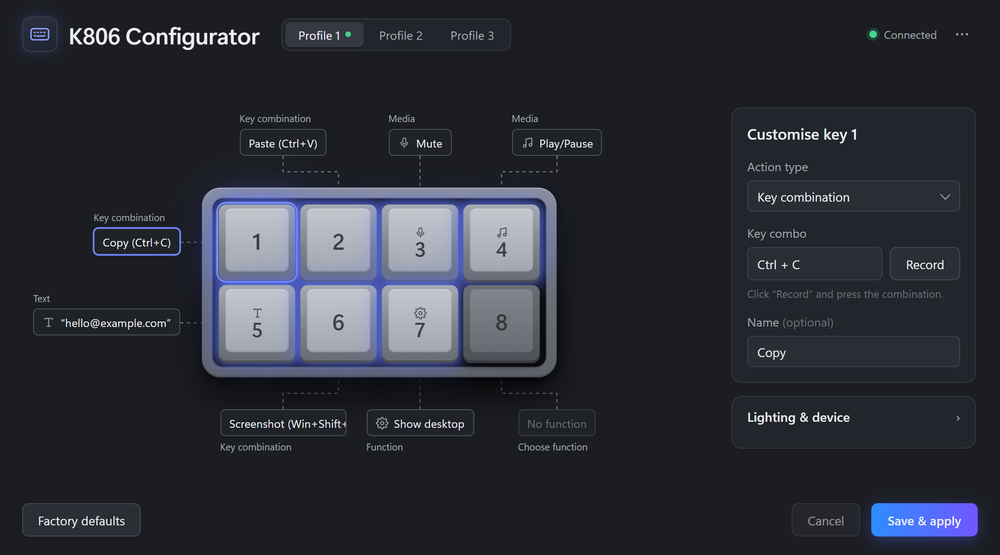
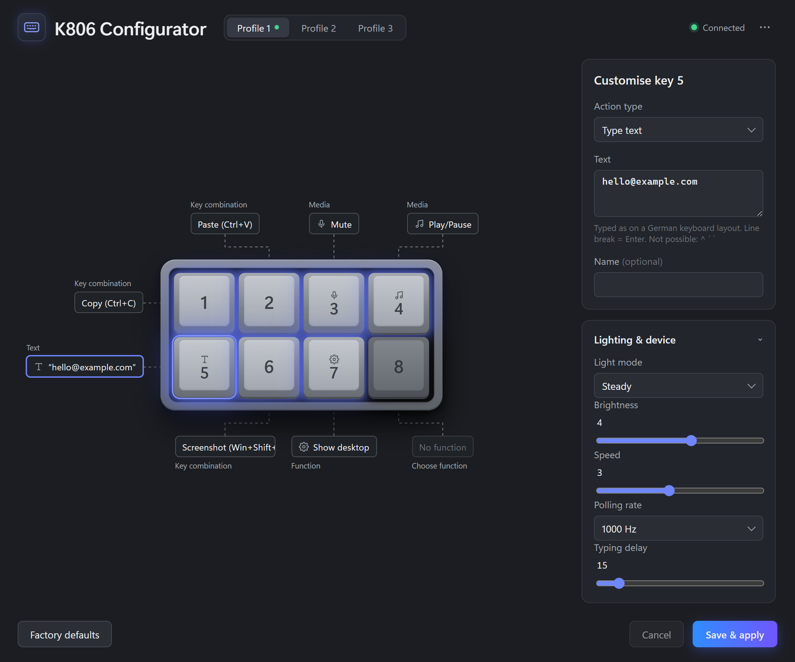
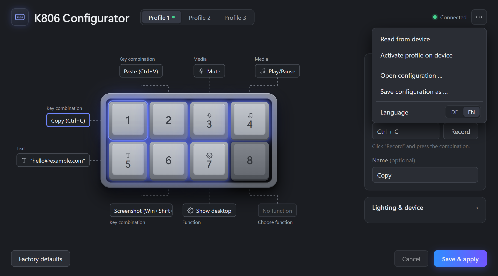

<div align="center">


# K806 Configurator

**A modern, open-source replacement for `X806.exe`, the software for the K806/X806 8-key macro pad.**

Remap keys, type text, control media, set up lighting, and keep 3 profiles on the device.
Built with Rust and Tauri, so it's small and fast.




</div>

---

## ✨ Features

- 🎹 **Visual key layout.** The pad is drawn on screen with a label for each key showing what it does. Click a key to edit it.
- ⌨️ **Key combos you can record.** Click *Record* and press e.g. `Ctrl + Shift + S`, or type the combo in.
- 📝 **Text expansion.** One key press types up to 120 characters: e-mail addresses, snippets, and multi-line text.
- 🎵 **Media keys.** Play/pause, next/previous track, volume, mute, calculator, browser, mail.
- 🖱️ **Extra functions.** Mouse buttons, double click, auto-fire, show desktop, profile switch, LED cycle.
- 🗂️ **3 on-device profiles.** Each profile can have a name, and you can switch profiles from the app or from a key on the pad.
- 💡 **Lighting.** Steady, cycle breathing, single breathing, reactive, or off, with brightness and speed settings.
- ⚙️ **Device settings.** Polling rate (125–1000 Hz) and typing speed.
- 💾 **Plain TOML config.** Changes auto-save. You can open/save configs as files, read the current setup back from the device, and keep the files in version control.
- 🌍 **English and German UI.** Picks the system language at first start and can be changed from the menu.
- 🔌 **Stays on the device.** Settings are written to the pad's flash memory, so the pad keeps them on any PC, without this app installed.

## 📸 Screenshots

<table>
  <tr>
    <td width="50%"></td>
    <td width="50%"></td>
  </tr>
  <tr>
    <td align="center"><sub>Text key + lighting &amp; device settings</sub></td>
    <td align="center"><sub>Read from device, open/save configs, switch language</sub></td>
  </tr>
</table>

## 🚀 Getting started

### Prerequisites

- Windows 10/11
- [Rust](https://rustup.rs/) (stable)
- [Node.js](https://nodejs.org/) and [pnpm](https://pnpm.io/)
- The [Tauri prerequisites](https://v2.tauri.app/start/prerequisites/) (WebView2, MSVC build tools)

### Run in dev mode

```bash
cd gui
pnpm install
pnpm tauri dev
```

> [!IMPORTANT]
> Close the original `X806.exe` first. While it runs, no other program can access the device's HID interface.

### Build a release

```bash
cd gui
pnpm tauri build --no-bundle   # → src-tauri/target/release/k806-konfigurator.exe
pnpm tauri build               # + NSIS installer (downloads NSIS on first run)
```

### UI preview without hardware

`pnpm dev` starts the UI on its own in a normal browser at <http://localhost:1420>. A mock backend
([`gui/src/vorschau.ts`](gui/src/vorschau.ts)) fills it with sample data, so you can work on the UI without a device connected.

### Tests

```bash
cd gui/src-tauri
cargo test
```

## 🕹️ Usage

1. **Pick a profile** at the top. The green dot marks the profile that is active on the device.
2. **Click a key** on the pad and choose an action type on the right: *Key combination*, *Single key*, *Type text*, *Media*, *Other function*, or *None*.
3. **Optional:** give the key a name such as "Copy" or "Screenshot". The name is shown in the key's label.
4. **Lighting & device** has the LED mode, brightness, speed, polling rate, and typing delay.
5. Click **Save & apply** to write everything to the device.

The `⋯` menu has *Read from device*, *Activate profile on device*, *Open/Save configuration*, and the language switch.

Your configuration auto-saves to `%APPDATA%\de.x806.konfigurator\konfiguration.toml`.

## 📄 Configuration format

Configs are human-readable TOML. Key and function names are German identifiers, as in the device logic:

```toml
[allgemein]                 # general
aktives_profil = 1          # active profile
abfragerate_hz = 1000       # polling rate
tippverzoegerung = 15       # typing delay, 1–127 (lower = faster)

[beleuchtung]               # lighting
modus = "dauerlicht"        # dauerlicht | zyklus_atmen | einzel_atmen | tastenreaktion | aus
helligkeit = 4              # 0–7
geschwindigkeit = 3         # 0–7

[[profil]]
name = "Work"

[profil.belegung]           # key assignments
t1 = "kombi:strg+c"
t2 = "kombi:strg+v"
t3 = "medien:stumm"
t4 = "medien:abspielen"
t5 = "text:hello@example.com"
t6 = "kombi:win+umschalt+s"
t7 = "desktop_anzeigen"
t8 = "profil_2"

[profil.bezeichnung]        # optional key names shown in the UI
t1 = "Copy"
t2 = "Paste"
```

### Action reference

| Prefix | Example | Meaning |
|---|---|---|
| `taste:` | `taste:a`, `taste:f13`, `taste:eingabe` | Single key (German layout; `eingabe` = Enter) |
| `kombi:` | `kombi:strg+umschalt+esc` | 2–4 keys at once (`strg` = Ctrl, `umschalt` = Shift; the plus key is `plus`) |
| `text:` | `text:name@example.com` | Types text, max. 120 chars, newline = Enter |
| `medien:` | `medien:lauter`, `medien:abspielen` | Media: `lauter`/`leiser` (vol ±), `stumm`, `abspielen`, `weiter`, `zurueck`, `stopp`, `rechner`, `browser`, `mail`, `player` |
| *(none)* | `profil_1`, `led_zyklus`, `desktop_anzeigen` | Profile switch, LED cycle, show desktop, mouse functions (`linksklick`, `rechtsklick`, `doppelklick`, `dauerfeuer`, …) |

<details>
<summary><b>All config sections</b></summary>

| Section | Purpose |
|---|---|
| `[geraet]` | USB IDs (VID `0x30FA`, PID `0x1340`) and report length |
| `[allgemein]` | Active profile, polling rate, typing delay |
| `[beleuchtung]` | Lighting mode, brightness, speed, effects |
| `[[taste]]` | Named keys (`t1`…`t8`) → firmware slot |
| `[[profil]]` | Up to 3 profiles with key assignments, LED reaction, and labels |
| `[erweitert]` | Unknown fields and raw memory bytes, kept as-is when saving |

The embedded default config is [`konfiguration.toml`](gui/src-tauri/src/geraet/konfiguration.toml).

</details>

## ⚠️ Limitations

- **Text typing assumes a German keyboard layout** on the host. Dead keys (`^`, `´`, `` ` ``) can't be typed.
- **No timed macros.** Macros with delays or repeats aren't supported. Existing macros from the original software are read in as "off".
- **DPI settings are fixed.** The firmware is a gaming-mouse firmware. Its DPI area is written with the original's default values and can't be configured here.

## 🏗️ Project structure

```
.
├── gui/                        Tauri v2 app
│   ├── index.html              UI markup
│   ├── src/                    TypeScript frontend (no framework)
│   │   ├── main.ts             UI logic
│   │   ├── i18n.ts             English / German strings
│   │   └── vorschau.ts         mock backend for browser preview
│   └── src-tauri/src/geraet/   device logic in Rust
│       ├── protokoll.rs        HID feature-report protocol
│       ├── speicher.rs         device memory map
│       ├── funktionen.rs       key/media/function catalog
│       ├── konfig.rs           TOML format
│       └── konfiguration.toml  embedded default config
└── doku/
    └── PROTOKOLL.md            reverse-engineered protocol & memory map (German)
```

## 🔬 How it works

The original `X806.exe` was reverse-engineered: import table, strings, and disassembly of its HID code.
The pad turns out to run **gaming-mouse firmware** ("USB GAMING MOUSE"). Everything is configured
through 8-byte HID feature reports (report ID 7) on vendor usage page `0xFF01`, which write
blocks into the device memory and then commit them to flash.

The full protocol, command set, and memory map are in [`doku/PROTOKOLL.md`](doku/PROTOKOLL.md).

## 🤝 Contributing

Issues and PRs are welcome, for example a non-German text layout, more lighting effects, or support for other platforms.
Run `cargo test` before opening a PR.

---

<div align="center">
<sub>Not affiliated with the manufacturer of the K806/X806. Use at your own risk.</sub>
</div>
